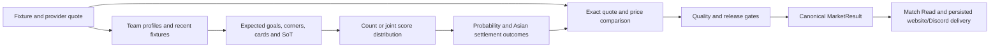

# Current prediction engine: data, weights and probabilities

Source review dated 28 September 2026. This describes the current canonical
pre-match path and the frozen Phase 4 control. It is a source audit, not an
attestation of code loaded by a running worker or a new provider-data audit.
No fitting or prediction-code changes were made for this walkthrough.

## The calculation in order

This is a configured statistical engine. The stored Ridge artifacts exist, but
current metadata/gating produces zero ML contribution. The editorial language
model explains numerical results; it does not set probabilities or select bets.
A prediction can exist without a recommendation or an executable price.

## Where the information comes from

API-Football is the intended provider for fixture identities/schedules, results,
team/player statistics, lineups and odds. `Index/platform.db` is canonical storage
for ingestion, research, scheduling, persisted cards/publications and measurement.
However, the existing numerical profile path in `core/team_resolution.py` reads
`team_profile` and `team_fixture` metadata from **Chroma**, using team/league/season
filters and aliases. It does not calculate every forecast directly from SQLite.
This is structured metadata retrieval, not a similarity score weighting the bet.

Consequently, eight seasons in canonical history do not imply eight seasons in a
current forecast, or that every imported season has regenerated live profiles.
The eight-season history import explicitly did not generate team/player profiles.
Offline research uses qualified canonical exports with exact provider identities;
it does not need new OpenAI embeddings to fit numerical models. Migrating the live
feature store would be a separate implementation decision.

The core uses goals scored/conceded; venue goals/xG; corners for/against; shots and
SoT for/against; legacy team card rates, opponent cards induced, fouls, aggression,
control/possession and form fields where available. Presence in a profile does not
mean every field influences every market. Optional context includes referee,
rest/congestion, recent regime change, standings/stakes, rivalry, knockout and
player/lineup information. Actual route coverage varies, as detailed below.

## How much history a forecast uses

| Component | Current source behavior |
|---|---|
| Season profile | All available valid current-season fixture rows before the forecast's calendar date; field means skip missing numerical values |
| Prior profile | Before eight current matches, blend a previous profile; the dated path chooses the newest **available** older season, which can skip a missing immediately preceding season |
| Recent form | Up to six fixtures in the target season and competition, strictly before the forecast date; it does not automatically fill an empty new-season window from last season |
| Recent variance | Up to eight target-season fixtures; at least three known values per statistic for a sample variance |
| Venue rates | Available current/prior profile home-only or away-only rows, then blended with overall rates |
| European profile | Domestic anchor when available; add continental profile at three current continental fixtures |
| European recent form | Up to six domestic and six continental fixtures, blended when both nonempty; the profile's three-match gate is not repeated in this recent-stat helper |

The production season resolver uses a July boundary. Dated lookup excludes the
whole target day because legacy fixture metadata is not reliably timestamped.
It is more conservative than a same-day kickoff-aware query, but does not prove
immutable original availability: historical rows may have been fetched/corrected
later. Undated legacy calls can use the newest profile and are not historical
replays. Missing fields can have smaller samples than the displayed match count. The
current Chroma team-fixture query also caps retrieval at 500 rows per alias
without pagination, so “all” means retrieved eligible rows, not a completeness
certificate for an arbitrarily large store.

For n current matches below eight, current weight is `n/(n+8)` and prior weight
is `8/(n+8)`. With a usable prior:

| Current matches | Current season | Prior season |
|---:|---:|---:|
| 0 | 0% | 100% |
| 1 | 11.1% | 88.9% |
| 4 | 33.3% | 66.7% |
| 7 | 46.7% | 53.3% |
| 8 or more | 100% | 0% |

Missing prior means current-only. Missing current field below the cutoff may
fall back to a known prior field. The code's `effective_sample_size` audit is a
support proxy (`current_n + min(prior_n, 8)`), not a statistical weighted ESS; it
can include prior support even after the prior numerical weight becomes zero.

The separate candidate uses prior weight `16/(n+16)` continuously. It is not
installed or substituted into the frozen control. Its earlier evaluation supports
some scopes, not all leagues/markets.

Recent-form weights are proportional to `.85^i`, newest fixture at i=0. With six
known observations the shares are 24.08%, 20.47%, 17.40%, 14.79%, 12.57%, 10.69%.
Missing observations are omitted and surviving weights renormalized; missing is
not generally a zero. This decay is per match, not elapsed calendar time. The
recent fixtures also contribute to season rates, so these are overlapping views,
not independent samples.

## How the expected counts are built

These coefficients are fixed configuration or hard-coded rules, not weights
learned from the newly collected eight seasons. They are generally shared across
leagues, although each league/team supplies different rates and context. An
unchanging coefficient does not mean identical predictions across leagues.

| Market | Team season-rate construction | Base season/recent blend for total |
|---|---|---|
| Goals | 60% own adjusted attack + 40% opponent goals conceded | 85% / 15% |
| Corners | 60% own corner rate + 40% opponent corners conceded | 80% / 20% |
| SoT | 60% own SoT rate + 40% opponent SoT conceded | 80% / 20% |
| Cards | 70% own card rate + 30% opponent card-inducing rate, then an aggression nudge | 85% / 15% |

Where both values exist, the own rate is 50% venue-specific and 50% overall. If
one side of a component is unavailable the code uses documented fallbacks; the
headline coefficient table therefore is not a universal formula for every row.
Opponent concessions in these primitives use overall rates, not matching venue
splits in every market. Home and away team forecasts are then combined.

**Goals/xG:** configured xG weight is **50%**, despite a stale docstring saying
60%. The code requires both home and away xG averages to form an overall xG rate,
takes their unweighted average, blends that 50/50 with actual goals, then blends
this result with the relevant venue actual-goal rate 50/50. Thus xG is not 50%
of the final goal projection. If either xG venue component is missing, this season
attack blend falls back to actual goals; there is no implemented overall-xG
fallback in this function despite a comment suggesting one. The recent goals
component is recent xG, when both teams have it; absent recent xG can leave the
season component alone. Configured additive home advantage is zero; venue rates
still supply home/away information.

For a simple illustration, before context adjustments: own adjusted attack 1.8
and opponent concessions 1.2 give a team forecast `0.6*1.8 + 0.4*1.2 = 1.56`.
This is an expected count, not a 56% probability of winning anything.

**Recent divergence:** if `abs(recent-season)/max(season,1)` exceeds 20%, the
engine moves up to 30 percentage points from season to recent. At 40% divergence,
the shift is 20 points: goals becomes 65/35 and corners 60/40. Additional trend
slopes are calculated, but their configured additive weight is zero.

**Cards:** the season primitive adds `0.05 * (2 * aggression_index)` and can
multiply by a referee modifier. The total path includes referee/foul anchors,
a 12% opponent-induced-card component, and a card-risk adjustment weighted 8%
and capped at ±0.25 cards. These are sequential adjustments, not one normalized
feature-weight vector. The configured yellow/red composition weights .82/.18 are
read but not used to rebuild the final total. The final yellow/red split is a
bounded ratio around the existing anchor. None of this establishes equivalence
to the approved weighted-participation settlement target. Additionally, the
canonical KB builder currently constructs `cards_total`/`cards_per_90_team` as
`(yellow_cards or 0) + (red_cards or 0)` (`data_platform/kb/doc_builders.py:270`).
That mapping can turn unknown card counts into numerical zeros in metadata.
It is not proof of a provider-confirmed zero, and the strict research target
contract must not inherit it. This source behavior needs a separately tested
missingness repair; the frozen control is retained as captured.

**Europe:** qualified profiles blend 80% domestic/20% continental; fewer than
three continental matches use domestic-only when available. Missing domestic
coverage uses the continental profile. Recent statistics have their own blend
rules, as above. Ordinary same-competition recent form should not be described
as full all-competition congestion coverage.

## Optional context: implemented does not always mean connected

The normal projections can apply bounded league-context adjustments. Existing
helpers derive rest/congestion, recent-five versus season changes, standings/stakes
and rivalry. Knockout modifiers are implemented and applied if a caller supplies
a knockout context; do not assume every public route supplies one.

Several lookups are not safe to invoke directly for historical research:
`league_context` obtains some recent rows/current profiles without forwarding the
historical cutoff; its regime helper also treats some missing values as zero.
Referee profiles are local/current aggregates, not dated reconstruction. The
automatic card referee lookup does not pass the forecast date, and its assignment
provider helper still has a pinned 2025 season. These are source-level limitations,
not proof of an observed current provider failure. Historical experiments must
inject supported dated contexts or disclose an equal neutral omission for all
systems. Any production repair needs a separate version; the frozen control
must not be silently corrected.

The lineup module verifies starting XIs and calculates missing-contributor
multipliers for goals, cards and SoT, with a neutral corners field in the normal
contribution lookup. However, those `home_adjustment` and
`away_adjustment` multipliers are not consumed by the canonical numerical path.
The connected numerical effect is card-risk context. That card-risk routine uses
the top eleven player profiles by playing-time indicators rather than filtering
to the confirmed starters. A `confirmed_xi` evidence label can therefore describe
the enclosing lineup context without proving the risk calculation used that XI.
These gaps are now explicit requirements in the richer-lineup plan.

## Expected counts become probabilities

An expected total alone does not determine the chance of over 2.5 or over 9.5.
The engine also specifies how outcomes vary around that mean.

For each team, available season/recent variances are blended **70% / 30%**.
The recent variance window is eight matches, distinct from the six-match mean
window. The two team variances are summed; if only one exists it is doubled.
Conservative total floors then apply:

| Market | Minimum variance used by generic count path |
|---|---|
| Corners | max(8, 1.50 × expected total) |
| Cards | max(4, 1.60 × expected total) |
| SoT | max(7, 1.60 × expected total) |

Variance greater than mean selects negative binomial; otherwise the generic
helper can use Poisson. These floors generally make the listed count markets
negative-binomial already. Consequently, merely comparing fitted NB against
Poisson does not compare against the actual production control.

Goals use a different repaired path: team expected goals feed one Dixon–Coles
score distribution with Poisson marginals and fixed rho **−0.10**, with goal-tail
tolerance 1e-10. Goals totals, BTTS, winner and score-matrix handicaps derive from
that shared distribution. Canonical goal variance comes from it; the legacy
max(2,1.25×mean) goal floor remains in quality provenance/caps rather than replacing
the shared goal distribution. A normal handicap fallback exists when no score
matrix is available; it must be distinguished in comparison coverage.

Integer and quarter lines retain probabilities for full win, half win, push,
half loss and full loss. The Asian equivalent non-push price-comparison probability
is not the probability of a full win. Expected return uses the five outcomes.

## Recommendation and confidence are further decisions

The engine pairs equivalent quotes by fixture, bookmaker, market, line, period
and rules, removes margin where matching opposing prices exist, and compares model
probability/Asian EV with the price. Current totals gates include odds at least
1.20, ordinarily model price-comparison probability ≥56%, edge ≥2 percentage
points and EV ≥2%; prices below 1.35 add stricter requirements. Other markets have
their own thresholds. Ranking also contains fixed edge/proximity/price bonuses;
it is not just sorting by calibrated EV.

Quality gates can suppress a selection: fewer than two current-season matches,
insufficient support proxy, unavailable/undated profile evidence, and cards without
a profiled referee. Confidence is a heuristic: the probability/edge branch uses
65% and 8 points for high, 55% and 3 points for medium, with sample/variance caps.
These labels are not measured uncertainty intervals or proof of calibration.

The Match Read compiler then chooses a core selection and up to two compatible
supports, or a legitimate no-bet result. The headline shortlist is capped at five
fixtures. Related same-game selections do not receive an invented independent
joint probability/EV. Persisted cards, later amendments and first-publication
measurement remain separate from the numerical model. Phase 5 evaluates and
changes selection/ranking policy; Phase 4 should not quietly tune these gates.

## What the audit implies for Phase 4

There is a functioning statistical mean engine and shared probability/settlement
architecture to preserve. The major research questions are whether the prior
transition, outcome spread, low-score dependence and calibration improve proper
scores, and which scopes support that conclusion. The current fixed coefficients
have not become optimal simply because source was frozen. Conversely, Phase 3's
lack of a promoted ML model does not prove this statistical engine is optimal.

See the [specific implementation and review plan](phase4-full-probability-comparison-plan-2026-09-28.md).
That plan distinguishes already-frozen comparisons from proposed amendments and
later lineup work. No full-engine fitting began during this walkthrough.

## Source map

- `Scripts/rag_ingest/core/team_resolution.py`: profile construction (775+), prior
  policy (900+), European profiles/recent (1140+), recent windows (1300+), variance (1550+).
- `Scripts/rag_ingest/core/weights.py`: configured coefficients; comments/defaults
  in functions do not override values here.
- `Scripts/rag_ingest/core/projections.py`: divergence (262+), count primitives
  (418+), goals/xG (535+), card adjustments (784+), shared score distribution (1398+).
- `Scripts/rag_ingest/core/market_service.py`: canonical variance, probabilities,
  exact quote decisions, data-quality and release contracts.
- `Scripts/rag_ingest/core/prediction_guardrails.py`, `line_selection.py`,
  `Scripts/rag_ingest/prob_models.py`: floors, support rules, selectors and arithmetic.
- `Scripts/rag_ingest/lineup_context.py`, `league_context.py`, `referee_data.py`:
  context generation and the historical/wiring limitations documented above.
- [Freeze report](phase4-baseline-freeze-2026-09-28.md) and
  [eight-season import](eight-season-history-import-2026-09-26.md): preserved scope.
